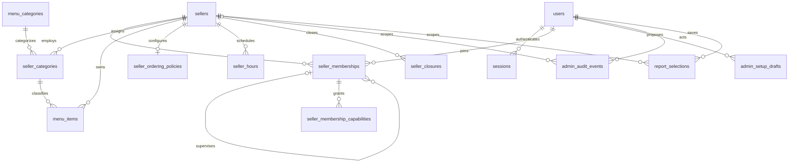
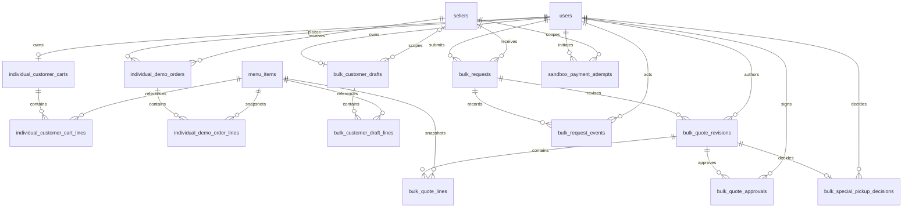
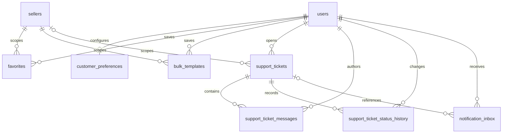
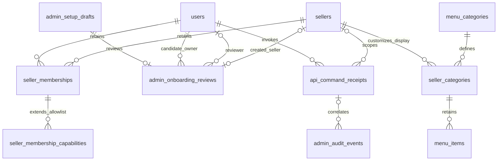
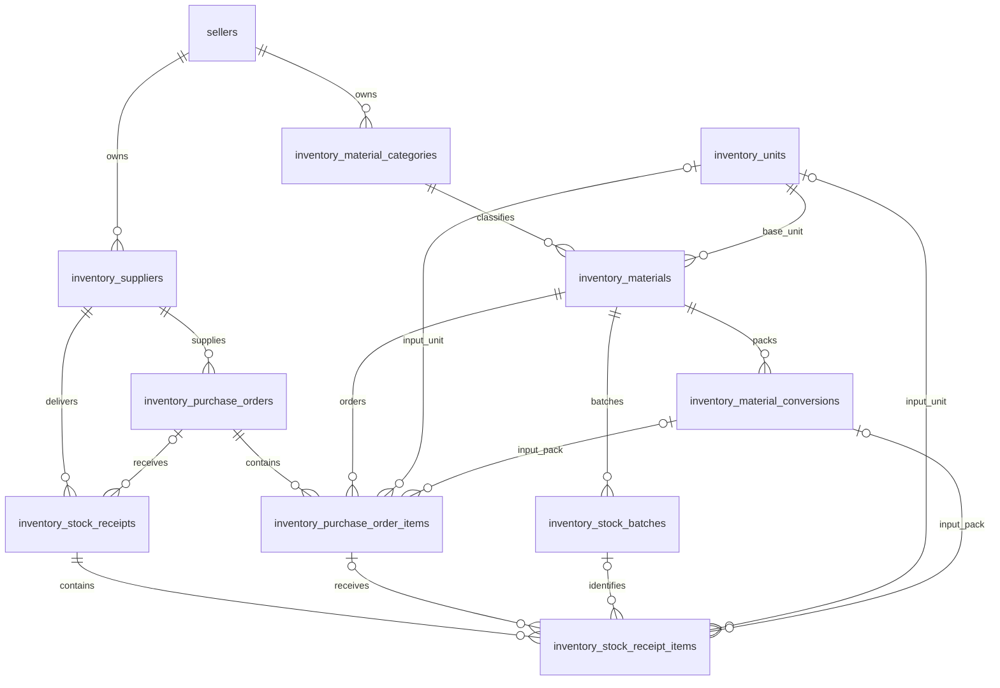
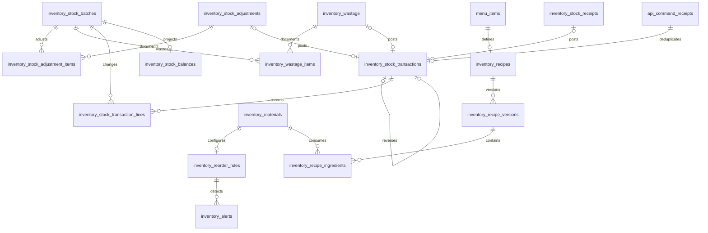

# Seller, Admin and Inventory backend schema alignment

Design date: 2026-10-30. Repository snapshot: `322ca29d510c8daa6e2a04ea2a11680bfc5d4056`, branch `feat/rit-verify-complete-backend-integration`.

**Status: design and verification only.** This document adds no application code, migrations or database changes. It refines the preliminary allocation in [the backend preflight](SUPABASE_BACKEND_PREFLIGHT.md), which is preserved as the earlier test record. The design retains one Ktor application, the existing PostgreSQL database and the existing account/authorization model.

## 1. Evidence, scope and current schema

| Evidence | Result and confidence |
| --- | --- |
| Local Git | Integration branch and HEAD above; the only pre-existing working-tree change was the untracked preflight report. Backend and Android tracked files have no changes. |
| Remote GitHub | Read-only branch listing confirms the same integration HEAD. Its migration directory and the local directory contain the same 16 migration filenames, ending at V047. No newer migration file is present in the inspected integration snapshot. Other branches and future work must still coordinate version allocation before implementation. |
| Supabase project `tnsvkqrzwapykioogtdu` | **User-confirmed:** 16 successful migrations through V047. **Not independently verified:** live table definitions, checksums, constraints, indexes, triggers, data, grants and RLS. No authorized read-only connection is configured; live comparison remains blocked. No connection or write was attempted. |
| Repository schema | All 16 migrations were inspected: `001, 002, 003, 004, 005, 020, 021, 022, 040, 041, 042, 043, 044, 045, 046, 047`. Gaps in numbering are intentional; do not fill them. |
| Local database evidence | The preceding preflight applied these migrations to disposable PostgreSQL 18.6: 34 application tables, 34 primary keys, 55 foreign keys, 97 CHECK constraints, 10 UNIQUE constraints and 76 indexes, excluding Flyway metadata. Index totals include constraint and partial unique indexes. One application trigger: `seller_supervisor_guard`. These are local facts, not live Supabase metadata. |
| Verification for this document | Source inspection, migration inventory, Git comparison, existing test-result inspection and document checks. The previous backend test run is recorded in section 10; proposed DDL and APIs have not been implemented or tested. |

Sources: [migrations](../../backend/src/main/resources/db/migration), [authorization](../../backend/src/main/kotlin/edu/msrit/canteen/backend/auth/AuthorizationService.kt), [commerce routes](../../backend/src/main/kotlin/edu/msrit/canteen/backend/features/commerce/CommerceRoutes.kt), [platform routes](../../backend/src/main/kotlin/edu/msrit/canteen/backend/features/platform/PlatformRoutes.kt), [analytics routes](../../backend/src/main/kotlin/edu/msrit/canteen/backend/features/engagement/AnalyticsRoutes.kt), [API contract](API_CONTRACT_V1.md), [commerce contract](COMMERCE_API.md) and [engagement/admin contract](ENGAGEMENT_ADMIN_API.md). Source wins where older handoffs disagree.

### 1.1 Existing ER model

These diagrams cover all 34 application tables. Edges show existing foreign-key relationships, grouped for readability; composite keys and integrity gaps are detailed below. Repeated entities connect the diagrams. Optional parents are marked `o|`. Logical payment/source and favorite/item links are deliberately described separately because they have no FK.







### 1.2 Keys, checks, indexes and reusable invariants

| Area | Existing enforcement | Consequence for additions |
| --- | --- | --- |
| Accounts | `users.id` UUID PK; normalized unique email; status `ACTIVE/SUSPENDED/DISABLED`; separate `is_platform_admin`; status index. Sessions have unique 32-byte token hashes, expiry/revocation checks and user/unrevoked-expiry indexes. | Preserve UUIDs, passwords and opaque sessions. There is no separate administrator identity or Supabase Auth dependency to create. |
| Sellers | `sellers.id` is a stable TEXT slug, not a user ID. `active` governs access. Partial unique main-canteen index permits at most one main canteen. | Never regenerate seller IDs, repurpose the main-canteen flag, or infer ownership from who created a record. New business tables use the existing seller FK. |
| Memberships | UUID PK; unique `(user_id,seller_id)`; user/seller FKs; OWNER/MANAGER/STAFF; self-referencing supervisor FK. CHECKs and trigger require OWNER without supervisor, MANAGER under same-seller OWNER, STAFF under same-seller MANAGER. Seller/active and supervisor indexes exist. | Reuse membership rows as staff records. Multiple owners are legal. Parent edits need validation of all affected children; the current child trigger does not enforce that. |
| Grants | PK `(membership_id,capability)`; cascade from membership; checked dotted lowercase names. Effective access also checks user, session, seller and the supervisor chain. | Reuse grants and extend the allowlist. No parallel inventory roles or employee tables. |
| Catalog | `menu_categories.id` and `menu_items.id` are globally unique TEXT PKs. `seller_categories` PK `(seller_id,category_id)`. Items already have UNIQUE `(seller_id,id)` and FK `(seller_id,category_id)`. Price is nonnegative BIGINT paise; kind, dietary, availability and visibility values are checked. Visible-menu partial index exists. | A recipe uses the existing `(seller_id,id)` target; do not add that unique constraint again. Seller-specific category display belongs on the existing join. |
| Operations | Policy PK/FK seller; bulk minimum 1-999; timezone restricted to `Asia/Kolkata`. Hours PK `(seller_id,day_of_week)`, one same-day interval with open before close. Closure PK `(seller_id,local_date)`. | Extend these aggregates; no duplicate schedules or operating-policy entities. Multiple shifts/overnight hours require a later explicit contract. |
| Bulk history | Request UUID PK and unique `(customer_id,idempotency_key_hash)`; revision PK `(request_id,version)`; line PK `(request_id,version,item_id)` and revision/menu FKs; approval PK includes actor kind; special decision PK `(request_id,version)`. Request events and seller/customer time indexes exist. | Preserve immutable quote snapshots, versions and approvals. Current request version is not FK-bound to a revision. A quote line's seller is not FK-bound to its request's seller. |
| Individual history | Order UUID PK; line PK `(order_id,item_id)`; menu FK `(seller_id,item_id)`; seller/customer time indexes. Partial unique `(customer_id,idempotency_key)` permits legacy null keys. Demo-only and payment-not-verified checks remain. | Preserve snapshots and all demo identities/statuses. A line's seller is not FK-bound to the order header. These tables are not a real paid-fulfillment contract. |
| Cart/drafts | Cart and bulk draft PK customer; version checks; line keys prevent duplicates. Bulk draft has UNIQUE `(customer_id,seller_id)` and its lines reference that pair. | Reuse existing optimistic versions and checkout idempotency; do not replace carts for inventory. |
| UAT attempts | UUID PK; customer/seller FKs; unique merchant order ID; unique `(customer_id,source_type,source_id,idempotency_key)`; partial uniqueness for INITIATED/PENDING/CANCELLED/SANDBOX_SUCCESS source attempts. Checked amount/state/source type. | Preserve these exact semantics. Source type/ID and quote version are logical links, not source FKs. No ledger effects from UAT or changes to PhonePe retry/reconciliation. |
| Administration | Setup draft UUID, proposed seller slug, DRAFT/ARCHIVED, creator FK; partial unique proposed slug for DRAFT. `proposed_seller_id` has no seller FK. Audit UUID, actor FK/role, optional seller FK, checked action name and JSON object details; actor/time and global time indexes. | Drafts are plans, not onboarded sellers. Reuse audit events for management and stock actions; add only missing metadata/indexes. |
| Other entities | Customer preferences, favorites, templates, support and inbox retain their current keys, FKs and cascades; report selections are unique by seller/name. | Favorites have a 2-63-character target constraint while item IDs allow 1-96; align validation before exposing unrestricted item creation. Templates contain JSON lines. Inbox events currently support support-ticket events only. |

Historical seller/menu/order relations generally restrict deletion. Cascades are explicitly present for grants, customer-owned auxiliary data and support children; they are not permission to delete accounts or history. No existing table should be dropped, renamed or copied into a replacement entity for this work.

## 2. Seller-management gap analysis

| Operation | Implemented now | Missing or defective | Proposed change |
| --- | --- | --- | --- |
| Catalog reads | Public seller/menu/detail reads and publication/availability filtering. | No private inventory of unpublished/archived items. Category `active` is not consistently honored; category sorting ignores configured sort order. | Private catalog resources; consistent category/archive filters in public reads and server-side pricing. |
| Item creation/update | PATCH name, description, paise price, publication, dietary and unavailable visibility; separate availability PATCH. | No create/archive/restore; category, kind and image-key management absent; no edit version. | Extend `menu_items` with archive timestamp/version. Keep existing PATCH routes; allow assigned category/image changes. Freeze kind once referenced by order history until a deliberate conversion contract exists. |
| Categories | Global category definitions and seller/category assignments exist. | No category management API or seller-specific label/order/activation. | Extend `seller_categories` with display-name override, sort order, active and version. Global definition changes remain administrative; do not duplicate taxonomy per seller. |
| Staff | Hierarchical memberships and capability calculation exist. | No list/add/update/deactivate/reassign APIs; no safe owner replacement or grant administration. | Operate on existing users/memberships/grants. Initial addition attaches an existing ACTIVE user. Invitations are deferred rather than represented as fake sent emails. |
| Roles/capabilities | Eleven named seller capabilities; OWNER gets all known capabilities. | No mutation policy, last-owner guard or complete validation when a supervisor changes. | Rules in section 7; serialize affected seller membership changes and validate the entire resulting hierarchy. |
| Operating policies | GET operating policy; PATCH bulk policy; PUT hours; PUT/DELETE dated closures. | No aggregate edit version; policy writes do not all use the same locking discipline. | Policy row is the aggregate lock/version for policy, hours and closures. Retain Kolkata calendar semantics and current one-interval limit. |
| Seller profile | Public profile read; `profile.edit` capability exists. | No management PATCH. | Update name/description through a private resource; seller ID and activation remain protected. |
| Individual/bulk operations | Demo individual queue/actions; bulk revisions/approvals and withdrawal; history exists. | Individual actions reuse bulk permissions; seller rejection endpoint is absent despite a rejected status; pickup schedule is an empty placeholder. | Preserve current contracts and identities. Implement rejection/schedule only with explicit transitions and capability review; these are separate commerce follow-ups, not prerequisites for inventory reference data. |
| Analytics | Dashboard/summary return request counts, support counts, simulated and sandbox totals. | No physical stock, wastage or procurement metrics; no verified revenue/cost/margin source. | Reuse the commerce read port; add separate inventory summaries. Clearly retain demo/UAT labels. |
| Reports | Saved report selections and export route exist. | Export currently returns 501; no material/batch/ledger CSV. | Implement bounded, streamed CSV using existing reports permission and read services; add inventory export. No export-job table unless asynchronous generation becomes necessary. |

Archive means exclusion from new selection/pricing, not deletion of existing references. Restoring an item does not automatically publish it. Historical order/quote snapshots remain readable even when the seller, category or item is inactive. Public and pricing readers must understand archive/category state before archive writes are enabled.

New private paths use `/catalog/items`, avoiding collision between a collection named `/menu/items` and the existing public `/menu/{itemId}` route.

## 3. Admin-management gap analysis and lifecycle

| Area | Implemented now | Proposed completion |
| --- | --- | --- |
| Platform administrators | Live `users.is_platform_admin` checks, independent of seller membership. | Explicit audited grant/revoke operation on that flag; serialize changes and forbid removal/suspension of the last ACTIVE administrator. No new administrator table. |
| Seller onboarding | Create/list/archive planning drafts only. DTO currently always says `sellerCreated=false`, `invitationSent=false`. | Add one review record per existing draft, approval/rejection, actual seller linkage and truthful DTO projection. Never claim an invitation was sent. |
| Seller oversight | Read-only seller directory/overview. | Detail, activation and suspension with expected version and mandatory reason. Reuse `sellers.active`; a second status column is unnecessary until additional runtime states have defined behavior. |
| User management | Read-only user directory. | Detail and status change with reason, version and session revocation. Keep account identity and historical FKs. No hard delete. |
| Membership administration | Core model exists. | Explicit admin seller-membership/owner/grant commands, with the same hierarchy and last-owner invariants. No implicit administrator bypass on ordinary seller routes. |
| Audit logs | Paginated reads; setup, support and report actions write events. | Audit all new lifecycle, grant, catalog and stock mutations in the same transaction; add seller/target filters and missing indexes. Existing commerce audit coverage is incomplete. |
| Platform analytics | Aggregated existing commerce/support summaries. | Explicit inventory oversight read with seller filters; no misleading verified-revenue metrics or stock-write privilege from the admin flag alone. |

### 3.1 Minimal onboarding extension

New `admin_onboarding_reviews`: `draft_id` PK/FK to `admin_setup_drafts`; `owner_user_id` FK to users; state PENDING/APPROVED/REJECTED; version; creation time; optional reviewer FK/time; decision reason; optional `created_seller_id` FK with uniqueness when non-null. State/field CHECKs require reviewer/time for decisions and a created seller only for APPROVED. The draft remains the source of proposed seller ID/name/notes; do not copy those editable fields into a second seller record prematurely.

Submit locks a DRAFT and records an existing ACTIVE owner candidate. Freeze draft edits while a review is pending or decided. Rejection archives the draft; a correction uses a new draft/review, preserving the decision. Approval is one transaction:

1. Recheck live administrator rights, command idempotency and expected draft/review versions; lock the draft, review and candidate owner account.
2. Verify the proposed slug is unused and the owner remains ACTIVE. A slug conflict is 409; never overwrite/adopt an existing seller with an upsert.
3. Create the seller with the proposed stable TEXT ID, `active=false`, `is_main_canteen=false`; create its OWNER membership and default ordering-policy row. Keep the current default bulk minimum of eight and create no invented hours or published menu.
4. Mark the review APPROVED and link the seller; archive the planning draft; write audit/command result atomically.

Activation is a separate audited action requiring a viable owner. Hours are not an activation prerequisite: inactive sellers cannot use ordinary seller configuration routes, so requiring owner-configured hours first would create a deadlock in the workflow. After activation, the owner configures hours/catalog; missing hours still disallow regular bulk pickup under existing rules. Deploy readers that derive `sellerCreated` from the review linkage before enabling approval.

Suspending/disabling a user revokes their sessions in the same transaction. Reactivation requires a fresh login and never unrevokes old sessions. Suspending a seller disables that seller's access without logging a multi-seller user out of other sellers. Keep existing accounts, membership UUIDs, orders and payment attempts intact.

Serialize platform-admin lifecycle changes with a shared transaction advisory lock. Serialize owner/membership changes using affected seller rows in a stable order. An active seller must retain at least one ACTIVE user's active OWNER membership. Suspending the sole viable owner requires a replacement or suspension of the affected seller in the same administrative command. Validate downstream supervisors before changing roles; membership deactivation may leave historical child links while live authorization denies the entire inactive chain.

## 4. Proposed extended ER model

Existing entities keep their names and keys. The first diagram shows management additions; the inventory diagrams show the proposed tables. Common seller and actor FKs are stated in section 5 instead of repeating every edge. A balance is a derived projection of ledger lines, not a second source of stock truth.







## 5. Inventory schema design

### 5.1 Conventions and ownership

- Business records carry `seller_id TEXT NOT NULL REFERENCES sellers(id)`. New document/master IDs are UUIDs; add UNIQUE `(seller_id,id)` where composite child FKs require it. The global, immutable standard-unit dictionary is the intentional exception to seller ownership.
- Every relationship between seller-owned entities must enforce the seller in its FK. Where material identity also matters, reference a unique `(seller_id,material_id,id)` tuple. Application filtering alone is insufficient.
- Monetary input uses integer paise and INR; quantities use PostgreSQL NUMERIC and Kotlin `BigDecimal`. Initial base quantity precision is `NUMERIC(20,6)`, conversion factors `NUMERIC(24,12)`, with explicit size bounds. API quantities/factors are decimal strings. Reject inexact base-quantity conversion beyond six decimals; never silently round received stock. Decide recipe consumption rounding before enabling consumption.
- Mutable masters/draft documents have version and timestamps. Actor fields reference existing users. Archive masters and cancel drafts; retain posted documents, batches, recipes used by history and ledger entries. Use restrictive FKs for history.
- One physical stock pool per seller initially. Do not invent warehouse/location entities or reserve stock until an actual location/reservation workflow is agreed.

### 5.2 Tables, keys and constraints

All names below are **proposed**, absent from V047. Common seller/actor/time/version fields follow section 5.1.

| Table | Fields and rules beyond common ownership |
| --- | --- |
| `inventory_material_categories` | UUID PK; seller-unique stable code; name; archive timestamp. These classify raw materials and are distinct from customer menu categories. |
| `inventory_units` | TEXT code PK; name/symbol; dimension MASS/VOLUME/COUNT; positive factor to canonical unit. Seed canonical g, ml, each and approved same-dimension units such as kg/L. Published definitions are immutable. |
| `inventory_materials` | UUID PK; seller/category composite FK; seller-unique normalized SKU; name; base-unit FK; expiry-required flag; archive timestamp. Initial base units are canonical g/ml/each. Base unit is immutable after any stock transaction. |
| `inventory_material_conversions` | UUID PK; seller/material composite FK; pack code/label; positive base quantity per pack; archive timestamp; unique seller/material/pack code among active definitions. Material-specific packs, such as a 25 kg rice sack, supplement global unit ratios. Referenced conversion definitions are immutable; create a new version/row when a pack changes. |
| `inventory_suppliers` | UUID PK; seller-unique code; name; optional contact details; active/archive fields. No globally shared supplier record or unnecessary sensitive bank data. |
| `inventory_purchase_orders` | UUID PK; seller/supplier FK; seller-unique order number; state DRAFT/APPROVED/PART_RECEIVED/RECEIVED/CLOSED/CANCELLED; creator/approver/timestamps. Approved lines are immutable. Closing a partly received PO records a reason for the unreceived remainder. |
| `inventory_purchase_order_items` | UUID PK; seller/PO and seller/material FKs; unique `(seller_id,purchase_order_id,line_no)`; positive ordered quantity; exactly one input unit or material-specific pack reference; factor/base-quantity snapshots; nonnegative paise price with explicit per-input-unit basis. Conversion must belong to the same material. |
| `inventory_stock_receipts` | UUID PK; seller/supplier FK; optional same-seller PO; supplier reference; received timestamp; DRAFT/POSTED/CANCELLED. If a PO is present its supplier must match. Direct receipts without a PO remain explicit and audited. |
| `inventory_stock_receipt_items` | UUID PK; seller/receipt and seller/material FKs; optional PO-item reference; unique receipt/line number; positive input/base quantity and factor snapshot; same unit/pack rules as PO lines; batch FK required at posting. A PO-backed line must reference a line of the header's PO for the same material. One batch per receipt line. |
| `inventory_stock_batches` | UUID PK; seller/material FK; seller-unique internal batch code; optional supplier lot; received date/time; optional expiry DATE; quality AVAILABLE/QUARANTINED. Supplier lot is not a unique business key. Even goods without expiry get an internal batch, avoiding nullable keys in balances. |
| `inventory_stock_adjustments` | UUID PK; DRAFT/POSTED/CANCELLED; mandatory reason, creator/poster, version. Used for documented opening quantities and counted corrections; never infer opening stock from old demo orders. |
| `inventory_stock_adjustment_items` | Parent/seller FK; material/batch composite FK; line number unique within document; nonzero signed base-quantity delta and count evidence where applicable. A negative correction must not create negative on-hand stock. |
| `inventory_stock_transactions` | Immutable UUID PK; seller; kind RECEIPT/ADJUSTMENT/WASTAGE/REVERSAL; actor/time/reason; unique command receipt FK; typed nullable source FKs (`receipt_id`, `adjustment_id`, `wastage_id`, `reverses_transaction_id`). CHECK requires exactly the source matching kind. Same-seller source FKs and partial unique source indexes allow one posting per source and one full reversal per original transaction. |
| `inventory_stock_transaction_lines` | PK `(seller_id,transaction_id,line_no)`; header composite FK; material/batch composite FK; nonzero signed base delta; optional source line number. Source correspondence, receipt-positive/wastage-negative signs and exact reversal lines must be enforced at posting and by deferred constraint guards where cross-row checks are needed. |
| `inventory_stock_balances` | PK `(seller_id,material_id,batch_id)` with matching batch FK; `on_hand >= 0`, version and update time. Derived from committed ledger lines; no editable quantity API. Reconcile by summing ledger; any physical correction uses an adjustment document. |
| `inventory_wastage` | UUID PK; DRAFT/POSTED/CANCELLED; reason code/text, creator/poster/version. Distinguish expiry, damage, spoilage and preparation loss. |
| `inventory_wastage_items` | Parent/seller FK; material/batch composite FK; positive wasted base quantity; unique document/line number. Posting appends negative ledger lines; no direct batch deletion. |
| `inventory_reorder_rules` | UUID PK; seller/material FK; unique seller/material initially; active; nonnegative threshold; target at least threshold; version. Quantity uses the material's base unit. |
| `inventory_alerts` | UUID PK; rule/material/seller relationship enforced; observed usable quantity and stock version; OPEN/ACKNOWLEDGED/CLOSED; timestamps/ack actor. Partial unique `(seller_id,rule_id)` while OPEN or ACKNOWLEDGED prevents repeated open low-stock alerts. Do not treat an acknowledgement as stock replenishment. |
| `inventory_recipes` | UUID PK; FK `(seller_id,menu_item_id)` to existing `menu_items(seller_id,id)`; unique seller/menu item; optional current published version; edit version; archive timestamp. Existing global menu-item IDs remain TEXT. |
| `inventory_recipe_versions` | PK `(seller_id,recipe_id,version)`; recipe FK; positive yield in menu-sale units; DRAFT/PUBLISHED; creator/published timestamps. Recipe's current-version pointer has a deferred FK to this exact version; service/constraint guard requires it to be published. Old published versions remain immutable. |
| `inventory_recipe_ingredients` | PK `(seller_id,recipe_id,version,material_id)`; recipe-version FK and seller/material FK; positive required base quantity for the recipe yield. Publishing requires at least one ingredient. No free-text ingredient or unscoped item references. |

Standard units only convert within their dimension. There is no generic grams-to-milliliters conversion; a density-based material conversion would need its own reviewed contract. Pack conversions store a material-specific base quantity, so they cannot be reused for another ingredient. Snapshot conversion factors on documents preserve history when suppliers change packaging.

Some consistency rules cross rows and cannot be implemented as ordinary CHECKs: receipt supplier/PO agreement, receipt line membership of that PO, material/pack identity, posted document completeness, recipe non-emptiness and complete reversal equality. Prefer composite FKs and paired-null CHECKs; use narrowly scoped deferred constraint triggers for the remaining posting invariants. A nullable composite FK with MATCH SIMPLE alone must not allow a partially null reference to bypass enforcement.

Require expiry on posted batches for materials marked expiry-required. Initial assumption: stock is usable through `expires_on` in Asia/Kolkata and expires at the next local midnight; confirm before implementation. Expired/quarantined quantities remain physical on-hand stock, excluded from usable stock. They may be wasted or returned through a defined document, never silently removed. Already-expired receipt policy needs a decision (reject or quarantine). Do not use time-dependent CHECK constraints such as `expires_on >= CURRENT_DATE`.

### 5.3 Ledger posting, idempotency and concurrency

Use the existing `BackendContext.transaction` with one JDBC connection. A service owns the transaction; repositories accept that connection and do not independently commit.

1. Recheck the live session, ACTIVE account, active seller, membership chain and required capability within the transaction. Claim an `api_command_receipts` key scoped to seller/actor/operation; hash the canonical validated request. Same key and payload replays the stored result after current authorization; a different payload is 409.
2. Lock the affected purchase-order header/lines, then business document where applicable; require expected version and valid transition. Use the same lock order for receipt, cancellation, closure and reversal paths. Do not permit overreceipt: committed receipts minus their reversals cannot exceed ordered base quantity. The default tolerance is zero.
3. Lock all affected material rows in sorted UUID order as stable anchors for **every** stock write. Then create/lock batch balances in sorted key order. Material anchors also serialize creation of new batches/balances and prevent a new-batch race during allocation.
4. Validate unit snapshots, batch/material ownership, expiry/quality policy and remaining quantities under those locks. Update balances with a guarded `on_hand + delta >= 0` condition; require every expected update to succeed.
5. Insert the immutable transaction/lines; mark the source document POSTED and advance its version; update PO state where relevant; write audit and command result; update low-stock alerts. All effects commit together or roll back together. No network call belongs inside this transaction.
6. Retry bounded deadlock/serialization failures with the same idempotency key. A crash before commit leaves no posting; a lost response after commit replays the result. A unique source-document index prevents double posting with a second HTTP key.

At READ COMMITTED, these explicit locks are sufficient only if all writing paths follow them; test that assumption with concurrent independent connections. The balance is a projection: `on_hand = SUM(committed ledger deltas for the batch)`. Use immutable ledger permissions/guard triggers with a separate migration owner when deployment grants permit; live grants are unknown and must be reviewed before provisioning roles. Until then, runtime services must expose no ledger UPDATE/DELETE path.

Full reversal appends a new transaction containing the exact opposite deltas and references the original. Lock the same PO/material/batch rows, update PO receipt totals/state, and reject any negative resulting balance. Do not edit the original ledger or delete its business document. Initially permit one full reversal, no reversal of a reversal, and no partial reversal. For example, a received batch already partly consumed cannot simply be reversed below zero; use a separately authorized correction workflow. Posted/reversed status is derived from posting/reversal links rather than a caller-supplied flag.

Low-stock alerts use usable stock, so a daily Kolkata expiry reevaluation is required even on days with no movement. Use the same material lock when changing quarantine state or reevaluating alerts. Inbox delivery is not implied: the current `notification_inbox` only accepts support events. Initial alerts are inventory resources; any push/email/inbox delivery needs a separate contract.

### 5.4 Recipes and future consumption

For a published recipe, ingredient demand is `menu quantity / recipe yield * ingredient base quantity`. A future consumption document must snapshot the recipe version, computed quantities and allocated batches, with FEFO ordering among eligible batches and an immutable allocation record.

**Do not decrement stock for existing demo completion, simulated payment, or PhonePe UAT success.** No verified real-order fulfillment entity/transition currently provides an appropriate consumption trigger. Recipe management, receipts, adjustments and wastage can ship independently. Before implementing consumption, define the real fulfillment identity, cancellation/return behavior, partial fulfillment, reservation policy and rounding. Then allocate the next unused migration for consumption headers/lines with typed same-seller FKs to that entity and add the corresponding ledger source/kind. No production-order table, polymorphic source string, or migration-number hole is created speculatively here.

Procurement price snapshots support purchase reporting, not a claim of inventory valuation or verified margin. FIFO versus weighted-average valuation, taxes and cost adjustments remain decisions before financial inventory reporting.

### 5.5 Index plan

Reuse existing PK/UNIQUE indexes; PostgreSQL does not automatically create indexes on referencing FK columns. Add only indexes supported by the expected reads:

- Material lookup `(seller_id,category_id,archived_at,name)` and seller/SKU uniqueness; conversions `(seller_id,material_id)`.
- Supplier code uniqueness; PO and receipt queues `(seller_id,status,created_at,id)` plus supplier/history and parent-line FK indexes.
- Batch selection `(seller_id,material_id,expires_on,id)` for available quality, plus material/batch FK indexes. Avoid a partial predicate based on today's date.
- Transaction history `(seller_id,occurred_at,id)`; line history `(seller_id,material_id,transaction_id)` and batch lookup; source uniqueness as above.
- One-open-alert partial uniqueness, seller/status/time alert queue; recipe/menu uniqueness and recipe-version/material FK indexes.
- Audit `(seller_id,occurred_at,id)` and `(target_type,target_id,occurred_at,id)` only if query plans justify them; existing actor/time and global time indexes remain.

Validate cardinality, lock duration and plans on representative disposable data before finalizing indexes. Do not add duplicate `(seller_id,id)` indexes already supplied by a unique constraint.

## 6. Proposed API contracts and module boundaries

All routes below are **planned** unless marked existing. Prefixes: `S = /api/v1/sellers/{sellerId}`, `I = S/inventory`, `A = /api/v1/admin`. Read collections use bounded pagination and explicit filters. Every resource lookup includes seller scope. Caller-supplied seller IDs in bodies cannot override the URL or ownership derived from a record.

### 6.1 Seller APIs

| Method and path | Purpose/important contract | Permission |
| --- | --- | --- |
| GET `S/catalog/items`; GET `S/catalog/items/{itemId}` | Private catalog including unpublished/archived filter and edit version. | `catalog.edit` |
| POST `S/catalog/items` | Create global-unique item ID under this seller and an assigned category; price in paise; idempotency required. | `catalog.edit` |
| PATCH `S/menu/items/{itemId}` (existing) | Retain existing fields/response; extend reviewed mutable metadata and optional version precondition. | `catalog.edit` |
| PATCH `S/menu/items/{itemId}/availability` (existing) | Retain availability semantics; add optional version precondition. | `availability.edit` |
| POST `S/catalog/items/{itemId}/archive`; POST `.../restore` | Expected version; preserve all historical references; restore unpublished. | `catalog.edit` |
| GET `S/catalog/categories`; PUT `S/catalog/categories/{categoryId}` | List assignments or attach/update an existing global category's seller label/order/active state; creation and replacement semantics explicit. | `catalog.edit` |
| POST `S/catalog/categories/{categoryId}/archive`; POST `.../restore` | Deactivate/reactivate assignment, never delete a referenced join. | `catalog.edit` |
| GET `S/memberships`; POST `S/memberships` | List staff or attach existing `userId`, role, supervisor and explicitly chosen grants. | `employees.manage` plus role restrictions |
| PATCH `S/memberships/{membershipId}` | Change MANAGER/STAFF role or supervisor with expected version and a complete affected-child plan. | `employees.manage` plus role restrictions |
| PUT `S/memberships/{membershipId}/capabilities` | Replace direct grant set; effective capabilities are returned separately. | `employees.manage` plus grant restrictions |
| POST `S/memberships/{membershipId}/deactivate`; POST `.../reactivate` | Preserve membership/grants/history; reactivation requires grant review and a viable chain. | `employees.manage` plus role restrictions |
| PATCH `S/profile` | Name/description and version; cannot change identity, activation or main-canteen flag. | `profile.edit` |
| GET `S/operations/settings` | Private policy/hours/closures aggregate with version. | `hours.edit` |
| PATCH `S/bulk-policy`; PUT `S/hours`; PUT/DELETE `S/closures/{localDate}` (existing) | Share aggregate policy lock/version; preserve existing request shapes and optional precondition rollout. | `hours.edit` |
| GET `S/dashboard-summary`; GET `S/analytics/summary` (existing) | Preserve stored/demo/UAT distinction; extend through deliberate DTO compatibility review. | `analytics.view` |
| GET/POST `S/reports/selections`; GET `S/reports/export` (existing) | Complete export behavior with bounded date/metric selection and streamed CSV. | `reports.export` |

Owner assignment/replacement initially uses explicit administrator operations below. Owners manage managers/staff but cannot use ordinary membership PATCH to create another OWNER or bypass last-owner safeguards. Seller rejection and pickup-schedule completion require a separate commerce contract; no new payment or fulfillment endpoint is proposed by this schema task.

### 6.2 Admin APIs

All entries require a live ACTIVE platform administrator; seller membership alone never grants these routes.

| Method and path | Proposed behavior |
| --- | --- |
| GET `A/sellers/{sellerId}`; GET `A/users/{userId}` | Detail/versions alongside existing directory APIs, with minimal necessary account information. |
| GET/PATCH `A/setup-drafts/{draftId}` | Read/edit an unsubmitted DRAFT; existing create/list/archive routes remain. |
| POST `A/setup-drafts/{draftId}/submit`; GET `.../review` | Create/read review with candidate existing owner; reject edits after submission. |
| POST `A/setup-drafts/{draftId}/approve`; POST `.../reject` | Execute section 3 lifecycle with review/draft versions and decision reason. |
| POST `A/sellers/{sellerId}/activate`; POST `.../suspend` | Reason/version; activation checks viable owner; suspension preserves all identities. |
| POST `A/users/{userId}/status` | ACTIVE/SUSPENDED/DISABLED transition, reason/version; session revocation and affected-owner safeguards. |
| PUT `A/users/{userId}/platform-admin` | Boolean grant/revoke, reason/version; serialized last-active-admin protection. |
| GET/POST `A/sellers/{sellerId}/memberships`; PATCH `.../memberships/{membershipId}`; PUT `.../memberships/{membershipId}/capabilities` | Explicit oversight of existing account membership, role, supervisor, active state and grants. Require reason/version and validate resulting hierarchy. |
| PUT `A/sellers/{sellerId}/owners` | Replace active owner set atomically using existing user/membership identities, explicit reparenting of affected managers and expected seller/membership versions. Forbid ownerless active seller. |
| GET/POST `A/catalog/categories`; PATCH `.../categories/{categoryId}`; POST `.../categories/{categoryId}/archive`; POST `.../restore` | Manage global taxonomy, with reason and affected-seller preview on deactivation. No seller-scoped call can rename another seller's shared category. |
| GET `A/audit` (existing) | Add bounded seller, target, actor, action and time filters; no update/delete endpoint. |
| GET `A/sellers/{sellerId}/inventory/summary` | Explicit read-only oversight, usable/physical stock and wastage totals; no stock mutation bypass. |
| GET `A/overview`; GET `A/analytics/summary` (existing) | Retain current semantics; keep unverified revenue absent. |

### 6.3 Inventory APIs

All inventory mutations require `inventory.view` **and** the listed capability. GET list/detail operations require `inventory.view`; export additionally requires `reports.export`. Each new mutation uses command idempotency; modifications/postings require expected versions. No DELETE endpoints remove stock history.

| Method and path | Purpose | Additional mutation capability |
| --- | --- | --- |
| GET `I/units` | Read immutable unit dictionary. | No unit mutation API initially |
| GET/POST `I/material-categories`; PATCH `.../{id}`; POST `.../{id}/archive` or `.../restore` | Raw-material classification. | `inventory.materials.manage` |
| GET/POST `I/materials`; GET/PATCH `.../{id}`; POST `.../{id}/archive` or `.../restore` | Material reference data and base-unit rules. | `inventory.materials.manage` |
| GET/POST `I/materials/{materialId}/conversions`; POST `.../{id}/archive` | Define material pack or retire one; referenced values cannot be edited. | `inventory.materials.manage` |
| GET/POST `I/suppliers`; GET/PATCH `.../{id}`; POST `.../{id}/archive` or `.../restore` | Seller-specific suppliers. | `inventory.suppliers.manage` |
| GET/POST `I/purchase-orders`; GET/PATCH `.../{id}`; POST `.../{id}/cancel` or `.../close` | Create/read/edit drafts; cancel unreceived orders or close remainder with reason. PATCH replaces validated draft lines atomically. | `inventory.purchase.manage` |
| POST `I/purchase-orders/{id}/approve` | Freeze lines/price snapshots; approval version and reason. | `inventory.purchase.approve`; OWNER/MANAGER only |
| GET/POST `I/receipts`; GET/PATCH `.../{id}`; POST `.../{id}/cancel`; POST `.../{id}/post` | Draft goods receipt; posting creates stock exactly once; cancel only unposted draft. | `inventory.stock.receive` |
| GET `I/batches`; GET `I/batches/{id}`; POST `I/batches/{id}/quality` | Read batch/expiry or set AVAILABLE/QUARANTINED with reason/version; quality change does not alter quantity. | `inventory.stock.adjust` for quality |
| GET `I/stock`; GET `I/transactions`; GET `I/transactions/{id}` | Physical/usable quantities, ledger and posting detail; no balance PATCH. | Read only |
| GET/POST `I/adjustments`; GET/PATCH `.../{id}`; POST `.../{id}/cancel`; POST `.../{id}/post` | Document opening/count correction and guarded posting. | `inventory.stock.adjust`; OWNER/MANAGER only |
| GET/POST `I/wastage`; GET/PATCH `.../{id}`; POST `.../{id}/cancel`; POST `.../{id}/post` | Document positive loss quantity and append negative ledger entries. | `inventory.wastage.record` |
| POST `I/transactions/{id}/reverse` | One complete reversal with reason and original transaction identity. | `inventory.stock.adjust` plus original posting capability; OWNER/MANAGER only |
| GET/PUT `I/materials/{materialId}/reorder-rule` | At most one versioned active rule per material. | `inventory.reorder.manage` |
| GET `I/alerts`; POST `I/alerts/{id}/acknowledge` | Read/acknowledge low stock; automatic closure follows recovery or rule deactivation. | `inventory.reorder.manage` |
| GET/POST `I/recipes`; GET `.../{id}`; POST `.../{id}/versions`; PUT `.../{id}/versions/{version}` | Create recipe for existing seller-owned menu item; create/edit unpublished recipe version. | `inventory.recipes.manage` |
| POST `I/recipes/{id}/versions/{version}/publish`; POST `I/recipes/{id}/archive` or `.../restore` | Select immutable published version; preserve older versions and item FK. | `inventory.recipes.manage` |
| GET `I/summary`; GET `I/reports/export` | Stock/expiry/wastage/procurement summary and bounded CSV. | `reports.export` additionally for export |

### 6.4 Shared contract rules

**Versioning:** retain `/api/v1` and existing JSON response shapes/status semantics. New private resources include `version`; new mutation DTOs require `expectedVersion` (zero for a first-time PUT where relevant). Existing PATCH/PUT callers can initially omit an added optional precondition or `If-Match`; all writers still increment the version. This leaves a documented legacy blind-write risk until old writers are retired or a separately versioned API makes preconditions mandatory. Do not assume Android clients ignore unknown JSON keys. Identity/type changes or mandatory-field changes need a separate versioned contract, not a silent v1 break.

**Idempotency:** add `api_command_receipts` for new management/inventory commands only: UUID PK, non-null `scope_key`, optional seller FK, actor FK, operation, key, 32-byte request hash, completion state, response status/sanitized body or result reference, timestamps. Unique `(scope_key,actor_user_id,operation,idempotency_key)`; scope is `PLATFORM` with null seller or `SELLER:<id>` with its FK, enforced by CHECK. This avoids SQL NULL uniqueness gaps. A provisional claim and its completed result live in the same transaction; a deferred guard prevents committing an incomplete claim. Replays require live authorization. Existing cart, bulk and UAT idempotency rules remain untouched.

New commands require `Idempotency-Key`; generated entity IDs are stable across replay. A first successful create returns 201, replay returns the stored status/body with a replay indicator header. Updates/actions return 200 with ID/version and relevant result; a stock post returns document ID, transaction ID and resulting version. Same key with different validated payload returns `IDEMPOTENCY_CONFLICT`. Do not prune stock command keys while associated posting history exists; permanent source uniqueness remains a second guard. Define management-command retention before cleanup is introduced.

**Errors:** retain the existing `ApiErrorEnvelope`: `{"error":{"code":"VERSION_CONFLICT","message":"...","details":{}}}`; details is optional. Use 400 for malformed/missing fields, 401 for expired/invalid session, 403 for denied capability, 404 for absent/out-of-scope entity, 409 for stale version/idempotency/state conflict, 422 for a validly formed command violating quantity/unit/stock rules, and 503 for exhausted transient DB retries. Proposed codes include `VERSION_CONFLICT`, `IDEMPOTENCY_CONFLICT`, `INVALID_UNIT`, `INSUFFICIENT_STOCK`, `LAST_ACTIVE_OWNER` and `LAST_ACTIVE_ADMIN`. Do not expose SQL, provider tokens or account existence beyond authorized scope. Map PostgreSQL constraint conflicts to domain errors deliberately.

**Audit:** reuse `admin_audit_events`; add optional command/request correlation and needed indexes. Successful changes append an event within the business transaction, including actor, actual seller/target, action, request ID, reason and a bounded before/after summary. Suggested actions follow the existing syntax: `seller.catalog.archive`, `seller.membership.grants_update`, `admin.seller.suspend`, `inventory.receipt.post`, `inventory.transaction.reverse`. Never store passwords, bearer tokens, SDK tokens, payment payloads or unrestricted personal data. Grant/activation changes and stock reversals require reasons. Failed/denied actions may go to sanitized operational logs; do not claim a rolled-back audit insert persisted. Runtime audit UPDATE/DELETE should be prohibited after deployment-role review. Audit events complement the stock ledger; they do not replace its accounting lines.

### 6.5 Module structure

Keep the existing modular application, configuration, authorization and data source. Introduce narrow boundaries for the work being added:

```text
features/seller/       SellerRoutes -> CatalogService / MembershipService / OperationsService
features/platform/     PlatformRoutes -> OnboardingService / AdministrationService
features/inventory/    InventoryRoutes -> MaterialService / ProcurementService / StockService / RecipeService
features/integration/  Existing CommerceReadPort adapter; add InventoryReadPort for summaries
core/                  Shared transaction, command-idempotency and audit infrastructure
api/                   DTOs, validation and mapping to the existing error envelope
```

Services own authorization-sensitive transaction boundaries and domain transitions. Repositories accept the current Connection and constrain every query by seller; pure domain functions handle quantity conversion and transition validation. Move existing write SQL only as needed to make the modified operation atomic; a project-wide rewrite is unnecessary. Consolidate new error/audit helpers without making Platform depend on Engagement internals. Keep PhonePe gateway/reconciliation and application startup migration behavior unchanged during this work. Production-sized report reads must not monopolize the current small connection pool.

## 7. Permission matrix and delegation rules

Existing capability names remain: `bulk.view`, `bulk.respond`, `operations.history`, `catalog.edit`, `availability.edit`, `hours.edit`, `promotions.manage`, `employees.manage`, `profile.edit`, `analytics.view`, `reports.export`.

Add only these inventory names to the same allowlist: `inventory.view`, `inventory.materials.manage`, `inventory.suppliers.manage`, `inventory.purchase.manage`, `inventory.purchase.approve`, `inventory.stock.receive`, `inventory.stock.adjust`, `inventory.wastage.record`, `inventory.reorder.manage`, `inventory.recipes.manage`.

`G` below means an explicit direct grant that is effective through the active supervisor chain. OWNER receives every allowlisted seller capability automatically; introducing inventory capabilities therefore intentionally grants them to owners. No migration silently grants them to managers/staff. Guests and ordinary customers have no management/inventory access.

| Operation | Required capability | OWNER | MANAGER | STAFF | Platform admin without membership |
| --- | --- | --- | --- | --- | --- |
| Catalog/category edits | `catalog.edit` | Yes | G | G | Global category routes only |
| Availability | `availability.edit` | Yes | G | G | No |
| Operations/hours | `hours.edit` | Yes | G | G | No ordinary seller bypass |
| Seller profile | `profile.edit` | Yes | G | G | Explicit admin lifecycle only |
| Member/grant management | `employees.manage` | Managers/staff | Direct staff only, G | Denied | Explicit admin membership routes |
| Owner replacement | Platform admin operation | No ordinary member PATCH | No | No | Yes, with invariant checks |
| Seller analytics / export | `analytics.view` / `reports.export` | Yes | G | G | Explicit admin summaries only |
| Inventory reads | `inventory.view` | Yes | G | G | Explicit admin summary only |
| Materials / suppliers | `inventory.materials.manage` / `inventory.suppliers.manage` plus view | Yes | G | G | No |
| PO draft/cancel/close | `inventory.purchase.manage` plus view | Yes | G | G | No |
| PO approve | `inventory.purchase.approve` plus view | Yes | G | Denied | No |
| Receipt posting | `inventory.stock.receive` plus view | Yes | G | G | No |
| Adjustments / quality | `inventory.stock.adjust` plus view | Yes | G | Denied | No |
| Wastage posting | `inventory.wastage.record` plus view | Yes | G | G | No |
| Reversal | `inventory.stock.adjust`, original posting capability and view | Yes | G | Denied | No |
| Reorder / alert acknowledgement | `inventory.reorder.manage` plus view | Yes | G | G | No |
| Recipes | `inventory.recipes.manage` plus view | Yes | G | G | No |
| Inventory export | `reports.export` plus inventory view | Yes | G | G | No ordinary seller bypass |
| User status / admin flag / seller activation | Live platform administrator | Only if separately admin | Only if separately admin | Only if separately admin | Yes |

Grant mutations cannot escalate the caller: a manager may grant only effective capabilities they hold, only to directly supervised staff, and may not change their own grants/supervisor/role. OWNER may manage managers and their staff, while owner assignment is an explicit admin operation. Staff cannot administer privileges even if an old unused `employees.manage` grant exists. Unknown names are rejected, not stored as effective permissions. Inventory writes additionally require inventory view; granting a write capability should validate that view is granted too.

Changing a supervisor/role must validate the resulting entire affected hierarchy and grant subset. Losing a supervisor grant or deactivating a parent immediately removes inherited effective access without deleting historical direct grants. Reactivation includes an explicit grant review, preventing surprising restoration of old authority. Multiple valid owners remain permitted; one is not hardcoded as the only possible owner.

The mutation authorization boundary must also be tested against concurrent deactivation/revocation. New writers and administration should share a documented locking order for affected account/session/seller/membership rows before business-document and material locks. Recheck authorization after acquiring those locks, and hold them until commit; do not rely on the authentication snapshot from the HTTP handler. Resolve the exact ordering across multi-seller account suspension in implementation tests before enabling writes.

## 8. Coordinated migration plan and compatibility

**V048 is the next unused version in the inspected local and remote integration snapshot.** The sequence below supersedes the preliminary allocation in the preflight. These are planned filenames/purposes, not files created by this task. A single integration owner must claim versions before parallel feature work; older branch ownership conventions covering V040-V059 are not permission to use conflicting numbers.

| Proposed version | Purpose | Dependencies and rollout gate |
| --- | --- | --- |
| V048 | `management_command_receipts_and_audit`: new command receipts; nullable audit command/request correlation; only justified missing audit indexes. | V047. Existing audit rows retain null correlation. Does not replace commerce/payment idempotency. |
| V049 | `seller_catalog_lifecycle`: item archive/version; seller-category display/order/active/version; policy aggregate version; favorite target validation alignment. | V048 for later commands. Existing records default active/unarchived and preserve existing visible behavior; deploy readers before archive/category writes. |
| V050 | `seller_membership_management`: membership version and strengthened parent/child hierarchy validation if needed after data inspection. | V048; no new employee/role tables or automatic staff grants. Preserve membership IDs; coordinate trigger behavior and multi-row reparenting. |
| V051 | `admin_onboarding_review`: review table, user/seller/draft edit versions. | V048, V050. Preserve flags/statuses/UUIDs. Upgrade setup-draft readers before approval creates a seller. |
| V052 | `inventory_material_reference`: material categories, standard units, materials, material pack conversions. | Existing seller identities and V048. Composite tenant keys from creation; no tenant fixture stock. |
| V053 | `inventory_procurement`: suppliers, purchase orders/items. | V052. Approved-order immutability and unit snapshots. |
| V054 | `inventory_stock_posting`: receipts/items, batches, adjustment documents/items, ledger headers/lines, balances and integrity guards. | V048, V052, V053. Create the complete atomic posting model together; no period with mutable stock lacking a ledger. Initially kinds RECEIPT/ADJUSTMENT/REVERSAL only. |
| V055 | `inventory_wastage`: wastage documents/items; add typed wastage FK and expand transaction kind/source CHECK. | V054. Replace the CHECK in this new migration transaction; preserve all existing receipt/adjustment/reversal rows. |
| V056 | `inventory_reorder_alerts`: rules/alerts and uniqueness. | V054. Expiry reevaluation and usable-stock semantics agreed before alerts enabled. |
| V057 | `inventory_recipe_versions`: recipes, versions, ingredients and current-version FK/guards. | V049, V052; recipe FK reuses existing menu-item composite unique key. No demo/UAT stock deduction. |
| V058, conditional | `validated_historical_integrity`: only evidence-supported missing seller/header FKs, related unique targets and measured indexes. | Historical prechecks, corrected writer/fixture ordering, and explicit resolution of any incompatible rows. Omit/reallocate this slot before release if no safe change is justified. |

Real fulfillment consumption is intentionally unallocated until its target schema/contract exists. Choose the then-next unused version; do not reserve a lower-numbered hole and later enable Flyway out-of-order execution.

### 8.1 Forward-only strategy

1. Before implementation, recheck every branch being integrated for higher versions and compare migration file checksums with the known base. Never edit V001-V047, run Flyway repair/clean, reset tables or lower the schema version.
2. Add nullable metadata/defaulted version fields and new tables first. Backfill only deterministic additive fields in reviewed batches; never rewrite seller IDs, account IDs, payment IDs, order snapshots or credentials. Existing item/category defaults must retain visibility until explicitly changed.
3. Rehearse both an empty database and V047-to-new upgrade on disposable local PostgreSQL, including a synthetic historical dataset with real key shapes. Use neither Supabase nor exported personal/payment secrets for tests.
4. Inspect historical anomalies before stronger FKs: seller mismatch between order headers/lines, orphan current bulk revision pointers and invalid supervisor chains. Missing enforcement does not prove live bad data. An authorized read-only metadata/data-integrity check is a future prerequisite; no live DDL is proposed here.
5. For large existing tables, add eligible FK/CHECK constraints as NOT VALID and validate only after the evidence supports it; unique constraints require duplicate prechecks and cannot use NOT VALID. Do not declare a cross-row invariant as an ordinary CHECK. Preserve existing constraints rather than adding equivalent ones under another name.
6. Header/line seller enforcement can reuse a header UNIQUE `(seller_id,id)` only where it is missing, then add the composite line/header FK. Evaluate bulk request/current-revision FK separately: creation order may require a deferred FK, and historical fixtures must first become valid. Do not make this unrelated hardening a prerequisite for basic inventory reference data.
7. Use transactional migrations where supported, bounded lock/statement timeouts and an explicit release window. A necessary concurrent index build requires its own reviewed nontransactional migration plan; do not place it casually in a transactional script.
8. Enable writers after compatible readers and authorization changes deploy. Recovery is a forward fix or disabling new writes while preserving data; never roll back by dropping history. Live application, grants/RLS and database engine must be checked before an eventual authorized deployment.

### 8.2 Compatibility guarantees and limits

| Existing asset | Required preservation | Verification scope |
| --- | --- | --- |
| Accounts/sessions | Existing UUIDs, normalized emails, password hashes and session hash format; no migration into Supabase Auth. Only explicit administrative status actions revoke sessions. | Source-level design confirmed; no live account mutation tested. |
| Seller identities | Keep TEXT slugs and existing main-canteen identity/partial unique rule. Create new sellers explicitly and inactive. | Recipe/material/member references use the existing seller key. |
| Memberships | Reuse UUIDs, supervisor graph and grants; no default new manager/staff capabilities. | Parent-edit and last-owner race tests required during implementation. |
| Orders/quotes | Preserve names/prices/statuses, customer/seller identities, version history, approvals and restrictive FKs. Archive only affects new selection. | Existing local tests pass; future stronger constraints need upgrade fixtures and anomaly checks. |
| PhonePe UAT | Preserve V047, merchant/provider references, SDK-token storage, attempt statuses, idempotency and partial uniqueness, including CANCELLED semantics. No ledger trigger or payment code changes. | Existing fake-gateway and V046-to-V047 upgrade coverage passed; no actual provider call or live UAT record was read. |
| Android/API clients | No Android edits or builds; existing v1 response contracts retained. New private resources carry new fields. | Current client compatibility remains a contract requirement, not an Android compilation claim. |

## 9. Implementation order, dependencies and unresolved decisions

### 9.1 Phases

| Phase | Deliverable and dependency | Acceptance evidence before moving on |
| --- | --- | --- |
| 0. Contract/evidence freeze | This report, version ownership, baseline; obtain authorized read-only live metadata only when configured. | Reconcile live checksums/schema/grants before any shared deployment. No credentials in chat. |
| 1. Management foundation | V048-V051; error/idempotency/audit helpers; catalog/staff/admin contracts and writers. | Existing account/seller/history fixtures survive; permission/revocation/last-owner/admin races; category/archive pricing behavior; onboarding truthful response. |
| 2. Inventory reference/procurement | V052-V053; material/unit/supplier/PO APIs using memberships. | Cross-seller FK and authorization rejection; unit/pack precision; immutable approved PO; idempotency/version conflicts. |
| 3. Stock accounting | V054; receipts, batches, adjustments, ledger/balances. | Concurrent receipts and deductions, duplicate keys/source IDs, rollback, exact reconciliation, overreceipt and negative-stock rejection; full reversal. |
| 4. Wastage and replenishment | V055-V056. | Expired/quarantined handling, loss posting, one-open-alert uniqueness, expiry without movements, acknowledgement/recovery. |
| 5. Recipes and reporting | V057; recipe publishing; existing report export and inventory summary/export. | Seller-owned menu/material FK checks, immutable published version, zero demo/UAT consumption, bounded and correctly labelled reports. |
| 6. Targeted historical hardening | Conditional V058, based on real metadata and synthetic rehearsals. | No unexpected FK/index duplication; all historical prechecks and upgrade tests pass before validation. |
| Later: real consumption | Real fulfillment/return/reservation contract and then new migration allocation. | Exactly-once ingredient issue, FEFO, cancellation/partial fulfillment and rounding defined/tested independently of payment sandbox logic. |

Inventory reference work can follow the shared command/auth foundation without waiting for every admin screen. Stock posting requires complete reference/procurement foundations. Recipes require existing catalog keys and materials, but do not require real payments. Reporting follows validated stock data. All phases remain within one application/database.

### 9.2 Risks and assumptions requiring decisions

1. **Live drift/access:** deployed V047/16 successes are user-confirmed; checksums, extra objects, grants, RLS and PostgreSQL version remain unknown. Do not infer direct Supabase REST access is protected by Ktor permissions. No live safety claim is made from local RLS being disabled.
2. **Legacy integrity:** current parent/child membership edits and order-line seller consistency have enforcement gaps; orphan/mismatched live rows are unverified. Preserve rows and resolve explicitly before validation. The existing migration-upgrade test uses minimal synthetic historical rows; additional constraints may require completing that fixture rather than weakening them.
3. **Category policy:** this plan uses platform-owned taxonomy with seller display overrides. Seller-private category creation is not assumed; it needs a distinct visibility/ownership decision if required. Raw-material categories are independent.
4. **Staff onboarding:** initial employee/owner addition requires an existing ACTIVE account. Email invitations, verified-address changes and password-reset administration need separate security/delivery contracts. No fake invitation state or default passwords.
5. **Authorization races:** last-owner/admin checks, role reparenting and concurrent revocation need coordinated lock ordering and adversarial tests. Existing OWNER auto-grants make allowlist additions immediately effective for owners.
6. **Editing compatibility:** optional version preconditions on existing v1 routes preserve callers but allow stale legacy writes. Mandatory optimistic concurrency requires an explicit migration of those callers or versioned contract.
7. **Physical inventory policy:** one stock pool per seller, six decimal base units, zero overreceipt tolerance, no automatic reservation, full-only reversals and inclusive expiry date are initial assumptions. Confirm count fractions, expired receipt policy and who can approve high-value purchases/losses before enabling writes. Staff can currently be delegated wastage in this proposal; financial approval thresholds are not modeled.
8. **Recipes/consumption:** yield is in menu-sale units, not arbitrary portion text. Fractional quantity/rounding, substitutions, returns and real fulfillment transitions remain unresolved; none may silently alter demo/UAT records.
9. **Cost and reports:** no verified revenue or cost-of-goods source exists. Purchase price snapshots alone do not establish FIFO/weighted-average valuation, tax accounting or margin. Large exports must respect the current small DB pool.
10. **Global unit governance:** only reviewed immutable standard units are seeded; tenant-specific packs are material-scoped. Density conversions and mutable unit factors are excluded until there is a safe historical model.
11. **Retention and privileges:** command receipts and audit events need a retention policy compatible with historical references; stock source uniqueness must remain permanent. Append-only runtime grants need a deployment-role review without changing shared grants during design.
12. **Release coordination:** no migration number is reserved on the remote by this document. Recheck branches/files immediately before adding scripts, and allocate additional versions if delivery order changes. Current recommendations supersede the earlier draft allocation only.

## 10. Verification record and stopping point

The prior preflight ran the independent backend Gradle build and tests against a newly initialized disposable PostgreSQL 18.6 cluster at `127.0.0.1:55437`, under ignored `backend/pgdata/preflight-20261030`. It did not use shared Supabase. That cluster was stopped successfully and retained; Docker's Linux engine was unavailable. The exact local setup/restart instructions remain in [the preflight](SUPABASE_BACKEND_PREFLIGHT.md).

| Check | Recorded result |
| --- | --- |
| Backend `compileKotlin compileTestKotlin --no-daemon --max-workers=1` | PASS, 5m39s; JDK Adoptium 25.0.4.101, Gradle wrapper 9.3.1. Three existing unnecessary `!!` warnings in `EngagementFeatureTest`. |
| First local test attempt | 49 executed, six failures caused by test-database safety checks: initial `rit_preflight_*` names did not satisfy required `rit_canteen_fresh` / `rit_canteen_legacy` names. This was corrected locally; not reported as a backend defect. |
| Corrected complete backend test run | **49 tests, 0 failures, 0 errors, 0 skipped; PASS, 1m35s.** |
| Test classes | BackendConfigTest 10; CloudDemoSecurityTest 1; DatabaseFoundationTest 4; AuthIntegrationTest 6; CommerceIntegrationTest 10; EngagementFeatureTest 12; CatalogParityIntegrationTest 3; CloudDemoDataSeedTest 2; SandboxMigrationUpgradeTest 1. |
| Existing artifacts | [JUnit XML directory](../../backend/build/test-results/test), [HTML report](../../backend/build/reports/tests/test/index.html), [corrected run log](../../backend/build/preflight-test-run.log). Local ignored artifacts may not be present in other checkouts. |
| This design turn | Re-read existing XML totals; rechecked HEAD, working tree, local/remote migration lists and relevant source. Compilation/tests were **not rerun** for this documentation-only addition. No proposed schema/API tests exist yet. |
| Blocked verification | Independent live Supabase metadata/data compatibility, deployed checksums and access controls. Proposed future DDL cannot be certified by the existing V047 tests. |

The deliverable is this design report. Existing preflight content is preserved. No feature implementation, new migration SQL, applied-migration edit, shared-database operation, PhonePe change, Android edit, commit, push, merge or deployment is part of this task.
